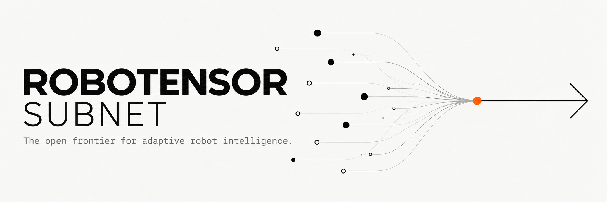

<p align="center">
  
</p>

<p align="center">
  <a href="LICENSE"></a>
  
  
</p>

<p align="center">
  <a href="#how-it-works">How it works</a> ·
  <a href="#mining">Mining</a> ·
  <a href="#validating">Validating</a> ·
  <a href="#horizon">Horizon</a> ·
  <a href="#development">Development</a>
</p>

---

**Attune** is a Bittensor subnet for robot foundation models, built by [Robotensor](https://www.robotensor.ai). Miners submit policy weights;
validators score them in simulation and set weights on chain. The rest of the emission pays the
people who collect robot data on Attune Horizon: see [Horizon](#horizon).

| Share of miner emission | Goes to |
|---|---|
| 30% | **Vector**, the policy competition below |
| 70% | **Horizon**, Robotensor's data platform: one vault UID, paid out to the people who collect data there |

The first competition is **Vector**: a policy (`vector_v1.1`) is shown one
demonstration of a task and must complete the same task in a different scene.

## How it works

| | |
|---|---|
| **Submission** | A Hugging Face model repo containing only `model.safetensors` (and an optional README). |
| **Commitment** | `vector:<owner>/<repo>@<commit>.<digest>` on chain: the revision and the sha256 of `model.safetensors`, in base64url. `attune miner commit` builds it; repo ids can be up to 49 characters long. |
| **Queue** | The validator queues a commitment as soon as it reads it from the chain, oldest first. **One submission per registration**: a UID's first commitment after it was registered is its only one, and every later one is refused. A hotkey swap does not reset it; registering again does. The validator reads this from the chain's history (an archive node), not from its own state. |
| **Scoring** | King of the hill. Each queued submission duels the current king on 240 units (16 tasks × 15), seeded from the finalized block when the duel starts. That block must come after the commitment. The challenger takes the crown when its average success rate beats the king's by 3+ points. |
| **Rewards** | The lane's share (30% of miner emission) goes to the 4 most recent champions: 40% / 30% / 20% / 10%, newest first. |

### Repositories and the kings' weights

A miner's repo is gated, with the permitted validator accounts (`hub.PERMITTED_VALIDATORS`) let in
and nobody else. The validator checks it when the entry's turn comes, and downloads the weights then.

- **Challenger not downloadable.** If the validator can't download the challenger's repo at its
  turn (deleted, private, gated without the validator let in, the revision is gone, or the Hub
  errors about it), it tries three times in all, at least 90 seconds apart. Then the entry is
  dropped as `missing` and the validator duels the next one. The hotkey's one submission is used up.
- **Failures on the validator's side.** An entry whose duel keeps failing (three times) goes behind
  the rest of the queue and keeps its submission, so nothing it does can hold the others up.
- **The validator's own problem.** A try only counts while the validator's token works and the Hub
  answers it. If the token is revoked or the Hub is down, the queue waits and nobody loses anything.
- **Kings.** From the download on, the duel runs on the validator's copy, and nothing asks the miner
  to keep the repo up. The four newest crowned models - the four that are paid - are kept by the
  validator (`var/<config name>/vector/kings/`) and mirrored to a public model repo (`kings_repo`), so
  anyone can take the weights a crown was won with. A new king pushes the oldest of the four out. No
  duel starts until the results hold every record and the reigning king's weights are on the validator
  and in the kings repo; the queue waits meanwhile, and a king never forfeits for lack of its weights.

Submissions are weights only. Nothing a miner uploads is executed or unpickled: the safetensors
header is checked against the pinned architecture before any tensor is read. Weights that don't
hash to the committed digest are refused. Weights identical to an earlier commitment's are refused
as duplicates, and the earlier commitment keeps them.

## Components

| Repo | Role |
|---|---|
| [`attune-subnet`](https://github.com/robotensor/attune-subnet) | Chain side: commitments, queue, seeds, weights, validator loop, miner CLI |
| [`vector-orchestrator`](https://github.com/robotensor/vector-orchestrator) | Duel engine, result store, `vector-runtime` and `vector-protocol` |
| [`RoboTwin-Vector`](https://github.com/robotensor/RoboTwin-Vector) | RoboTwin 2.0 fork with the level gate and the benchmark harness |

## Mining

A submission is a `vector_v1.1` weights file: `model.safetensors`, with exactly the tensors the
architecture pins (`vector_runtime/vector_v1.1.json` in the orchestrator).

```bash
pip install robotensor-attune

attune miner check --dir submission/

export HF_TOKEN=...
attune miner submit --dir submission/ --repo <you>/vector-mine \
    --network finney --netuid <N> --wallet.name miner --wallet.hotkey default
```

`submit` makes the repo private and gated (manual approval), lets the permitted validator accounts
in, uploads, commits on chain, then takes the repo out of private, gated still. It stays private until
then because a gated repo still shows anyone its commit and the weights' hash, which is all it takes
to commit them first. Nobody else can download your weights; if you are crowned, the validator
publishes them in its kings repo. The repo must be downloadable by the validator at the one moment
its turn comes: a repo it can't download then is dropped as missing. If `submit` reports the repo is
still private, run `attune miner reveal --repo <you>/vector-mine` at once.

Check your entry with:

```bash
attune miner status --hotkey <ss58> --network finney --netuid <N>
```

## Validating

One GPU host with three Python environments:

| Env | Python | Contents |
|---|---|---|
| simulator | 3.10 | RoboTwin-Vector (`robotensor_bench/scripts/install_robotwin.sh`), `vector-protocol` |
| policy | 3.12 | torch 2.8.0+cu128, `vector-runtime[model]`, `vector-protocol` |
| host | 3.12 | `robotensor`, `vector-orchestrator`, `vector-runtime` |

```bash
git clone -b vector https://github.com/robotensor/RoboTwin-Vector.git
git clone https://github.com/robotensor/vector-orchestrator.git
git clone https://github.com/robotensor/attune-subnet.git

uv venv --python 3.12 .venvs/subnet
uv pip install --python .venvs/subnet/bin/python -e attune-subnet -e vector-orchestrator \
    -e vector-orchestrator/packages/vector-protocol -e vector-orchestrator/packages/vector-runtime
```

Point `[vector]` in `config/<network>.toml` at the environments and your wallet:

```toml
network = "finney"   # or "test"
netuid = 0
wallet = { name = "validator", hotkey = "default" }

[vector]
policy_python = "/abs/.venvs/vector-policy/bin/python"
simulator_python = "/abs/.venvs/robotwin/bin/python"
simulator_root = "/abs/RoboTwin-Vector"
workers = 1   # units per GPU; one unit can use up to 34 GB
```

```bash
echo 'HF_TOKEN=hf_...' > config/.env   # read at start, for the validator and its workers; an exported variable wins
attune validator --config config/<network>.toml run
```

`status`, `weights --dry-run` and `duel --challenger owner/name@sha` are also available.

`HF_TOKEN` must belong to a permitted validator account (`hub.PERMITTED_VALIDATORS`), on any network,
or the validator does not start. It needs read access to gated repos and write access, since the
results and the kings go under that same account: `<account>/vector-results` (`mirror`) and the public
`<account>/vector-kings` (`kings_repo`). Both are bare names; off finney the defaults end in `-test` or
`-local`, and `""` turns one off.

Interrupted duels resume from `var/<network>/`. A new pod with the same token takes the competition up
from the results (the index, the king and who committed what; not the events or clips), works out who
the four kings are from how the duels went, then checks the kings repo against that: a king's weights
missing or wrong are put right and a dethroned one removed. Results that name no king never empty the
kings repo. The lane will not run on an empty store while the results cannot be read.

Disk is looked after by itself: the oldest finished duels' files are cleared when less than 300 GB is
free (`VECTOR_FREE_GB`), and the oldest downloaded checkpoints when `cache` holds over 200 GB
(`VECTOR_CACHE_GB`), never the running duel's. The kings have their own copy in `kings/`.

If a pod dies before its new king's weights reach the kings repo and the miner has since removed its
repo, the queue waits and the log names the king. To go on, upload those weights to the kings repo as
`<key>/model.safetensors`; they are checked against the sha256 the results recorded.

For rented GPU pods (vast.ai, lium.io), `docker/build.sh` builds an image with all three
environments, the assets and the checkouts. Run `pod-check --selftest` on a new pod.

## Horizon

70% of the miner emission pays for robot data: robot control in simulation, recordings and the
other work people do on [Attune Horizon](https://horizon.robotensor.ai), Robotensor's data platform.
Horizon checks and scores that work in points.

- **On chain**, Horizon is one registered hotkey, the vault, owned by Robotensor. Validators give it
  70% of their weights. Its hotkey is fixed in code per network (`VAULT_HOTKEYS` in `config.py`),
  so every validator weights the same one. While it is not registered, its share burns like a
  deregistered champion's.
- **Off chain**, Robotensor pays the people who collect data from the vault every week, split by
  their points, with `transfer_stake`. Nothing in this repository moves funds.
- **In the open**: every week's points, shares and payouts are on Horizon's
  [rewards page](https://horizon.robotensor.ai/dashboard).

Validators need nothing more than `attune validator run`: `weights --dry-run` shows the vault's
part beside Vector's. A test network or a local chain names its vault in the config:

```toml
[horizon]
vault_hotkey = "5..."
```

## Development

```bash
uv venv --python 3.12 .venv && uv pip install -e ".[dev]"
ruff check . && ruff format --check .
pytest -q -m "not chain and not gpu"
```

`scripts/localnet.sh up` and `scripts/localnet_setup.py` run the full loop against a local
subtensor, with a stand-in for Horizon's vault registered as a miner.

### Releasing the miner package

Miners install `robotensor-attune` from PyPI: the `attune` command with `init` and `miner`
only, and none of the validator. `miner/build.sh` lays out the miner's modules and copies
vector-runtime's weights check from the vector-orchestrator checkout beside this one; it refuses
a tensor manifest that is not the one `spec.json` pins. The version is `__version__` in
`src/robotensor/__init__.py`.

```bash
bash miner/build.sh                     # miner/dist/robotensor_attune-<version>-py3-none-any.whl
twine upload miner/dist/robotensor_attune-<version>-py3-none-any.whl
```

Rebuild and upload whenever the miner's commands or the architecture change. Validators do not
install it: their install from source has the same commands.

## License

[Apache-2.0](LICENSE)
